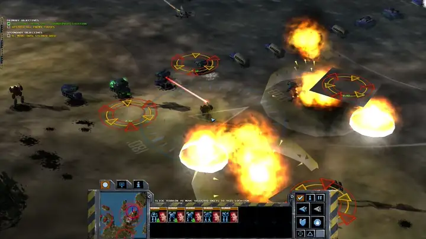
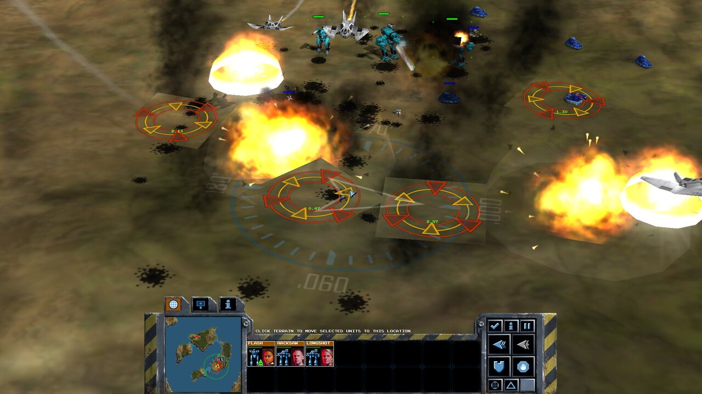
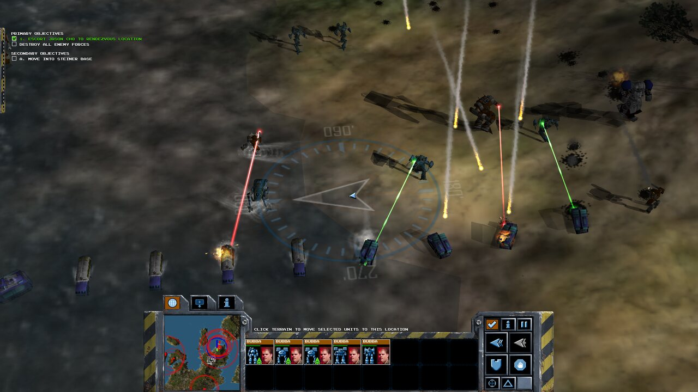
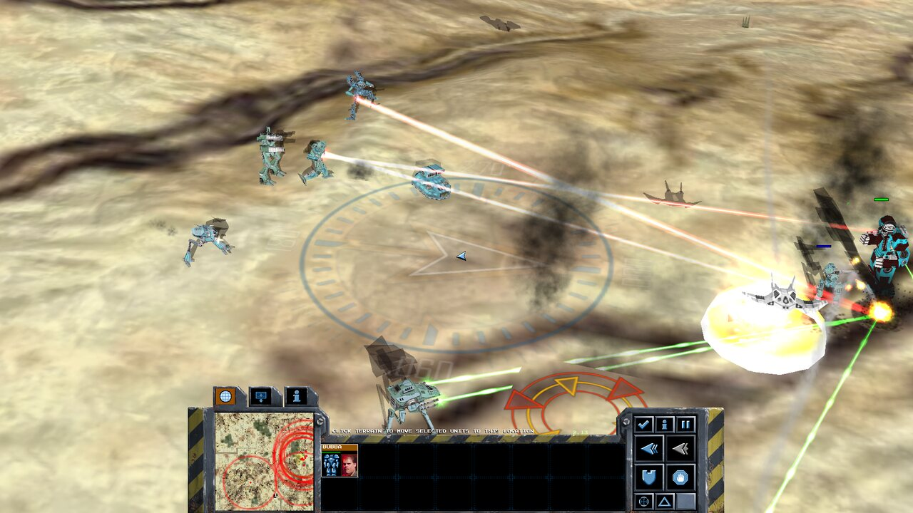
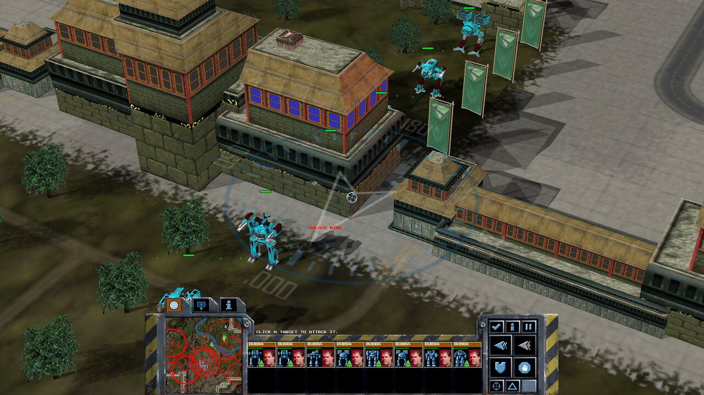

# MechCommander 2, updated

[](https://github.com/nicholasthorn/mc2-pi/actions/workflows/ci.yml)

A maintained update of [alariq's open-source MechCommander 2 engine](https://github.com/alariq/mc2)
for 64-bit Linux and Windows: current compilers, crash and undefined-behaviour
fixes, mod support (MechCommander Omnitech), and a test, sanitizer and CI setup
around the original code. On top of the usual desktop builds it also runs on
the **Raspberry Pi 4/400**, through an OpenGL ES 3.1 renderer and an arm64
build, and it is **playable in VR on a Meta Quest 2**, standalone, with the
Touch controllers.



| | |
|---|---|
|  |  |
| *Artillery on the first campaign mission* | *Lasers and missiles, with shadows and detail textures on* |
|  |  |
| *The fan-made [MechCommander Omnitech](https://www.moddb.com/mods/mechcommander-omnitech) and its Desert Fox campaign* | *A quieter moment: mechs among the buildings of mission 22* |

Scripted battles from the desktop build at 1920x1080
(`scripts/bench.sh --scenario`). The
game data, and Omnitech's, are not in this repository.

The main branch is called `pi-port` and the repository `mc2-pi` for
historical reasons: the Pi port is where this started.

## Relationship to upstream

- All credit for the engine port goes to [alariq](https://github.com/alariq/mc2)
  ([website](https://alariq.github.io/mc2-website/)). Game data comes from
  [alariq/mc2srcdata](https://github.com/alariq/mc2srcdata).
- **This fork is developed with AI assistance.** Upstream's README says
  AI-generated code is not welcome there, so please do not send changes from
  this fork upstream, and report problems with this fork here, not to alariq.
- Upstream `master` is merged in from time to time; changes here are kept small
  and local to make that easy.

## What this fork adds

**For every platform**

| Area | Status |
|---|---|
| Linux builds from Ubuntu 22.04 (GCC 11) to 26.04 (GCC 15), Clang and MSVC fixes | Done |
| Crash and undefined-behaviour fixes, many back-ported from [mc2-opengl-remastered](https://github.com/ThranduilsRing/mc2-opengl-remastered), more found by sanitizers and cppcheck | Done, ongoing |
| Fatal engine errors (`STOP`) end the game with a message instead of carrying on into a crash | Done |
| Mod content: MechCommander Omnitech, with all 28 Clan Wars missions, its front end and mech lab | Done: all missions load and pass a headless smoke run; mission 1 checked in play |
| Stereo panning for positional sound | Done |
| CI: four build configurations, unit tests (also under ASan + UBSan), shader validation, smoke missions, cppcheck | Done; the cppcheck baseline is empty (every finding fixed or suppressed with a reason) |
| Benchmarks: deterministic `-bench` runs, scripted battle scenarios with screenshots, `perf` profiles of gameplay frames | Done |
| Downloadable builds (Pi, Linux, Windows, Quest) | Release candidates on the [Releases](https://github.com/nicholasthorn/mc2-pi/releases) page ([planning/RELEASES.md](planning/RELEASES.md)); `-full` packages include the game data, the Quest still needs a PC to install ([plan](planning/future-features/EASY-INSTALL.md)) |

**Raspberry Pi 4/400**

| Area | Status |
|---|---|
| OpenGL ES 3.1 renderer (`-DMC2_GLES=ON`) for the Pi's V3D GPU | Done |
| Shaders valid as both GLSL ES 3.10 and GLSL 4.20, `#version` chosen at runtime | Done |
| arm64 (aarch64) build: signed `char`, portable heap, GCC 12 fixes | Done |
| Running on real hardware | Done on a Pi 400 at about 800x600: the GLES build runs mc2_01 at 179 fps and mc2_03 at 181 fps with vsync off (60 with it on); Mesa's software renderer manages 50 to 67 fps |

**Meta Quest 2 VR** ([planning/future-features/VR-TABLETOP.md](planning/future-features/VR-TABLETOP.md))

| Area | Status |
|---|---|
| Standalone Quest build: Android APK with OpenXR, sideloaded | Playable on a Quest 2, and now built by the release workflow |
| Head-tracked view, with the game camera covering the headset's field of view | Done |
| Touch controllers: aim, click and order units, pan, turn and zoom | Done |
| Frame rate | About 70 fps at the headset's 72 Hz on the `mc2_19` battle bench |
| Still rough | Open checks are in [planning/HARDWARE-TESTS.md](planning/HARDWARE-TESTS.md); only a Quest 2 has been tried, so a Quest 3 or Pro is untested |
| Tabletop mode, battlefield at miniatures scale | Planned, as an option |

## Platforms

| Platform | Renderer | Built in CI |
|---|---|---|
| Linux x64 (GCC, Clang) | Desktop GL 4.x | Yes |
| Linux arm64 / Raspberry Pi OS 64-bit (GCC) | OpenGL ES 3.1 | Yes |
| Windows x64 (MSVC, VS 2022) | Desktop GL 4.x | Yes |
| WSL2 / no GPU | Either, via Mesa llvmpipe (`LIBGL_ALWAYS_SOFTWARE=1`) | Smoke runs |
| Meta Quest 2 (standalone, Android) | OpenGL ES 3.1 + OpenXR | Release workflow, nightly and on tags; run by hand on a headset |

## Quick start

**Release packages** (on the
[Releases](https://github.com/nicholasthorn/mc2-pi/releases) page): download
the `-full` one for your platform, unpack and play. On Windows that is all; on
Linux and the Pi install a few libraries first ([dist/INSTALL.md](dist/INSTALL.md)).
Engine-only packages, without the game data, are there too. For the
Quest, sideload the `.apk` and push the data and shaders with `adb`; the steps
are in the same file.

**From source:** full instructions in [BUILD-LINUX.md](BUILD-LINUX.md),
[BUILD-PI.md](BUILD-PI.md), [BUILD-WIN.md](BUILD-WIN.md).

**1. Build the game** (Linux; on the Pi add `-DMC2_GLES=ON`):

```bash
cmake -S . -B build -G Ninja -DCMAKE_BUILD_TYPE=RelWithDebInfo
cmake --build build
```

**2. Build the game data** from a `mc2srcdata` checkout. The result is platform
independent: build it once and copy it to each machine, the Pi included.

```bash
git clone https://github.com/alariq/mc2srcdata.git ../mc2srcdata
scripts/build_gamedata.sh --src-data ../mc2srcdata --build-dir build --out ~/mc2exe
```

`--no-movies` skips the movies (the only part stored in Git LFS); missions run
without them.

**3. Run** from the game directory (copy `mc2`, `libmc2res_64.so` and `shaders/`
into it):

```bash
./mc2                      # main menu
./mc2 -mission mc2_01      # straight into a mission
```

## Development

| Check | Command | In CI |
|---|---|---|
| Unit tests (doctest, CTest) | `ctest --test-dir build --output-on-failure` | Every PR push and `pi-port` push, all four configurations; also under ASan + UBSan |
| Shader validation (GLSL ES 3.10 + 4.20) | `python3 scripts/validate_shaders.py` | Same as the unit tests |
| Smoke runs (missions under Xvfb + llvmpipe) | `scripts/smoke.sh --game-dir ~/mc2exe --build-dir build` | Nightly and on PRs that touch code: x64 desktop GL and arm64 GLES; sanitized on x64 |
| Benchmark (on the Pi, own display) | `scripts/bench.sh --game-dir ~/mc2exe --build-dir build --renderers gpu` | No: run by hand |
| Static analysis | `scripts/cppcheck_gate.py` against `scripts/cppcheck-baseline.txt` | Changed files on the same pushes, full tree nightly |

A push that changes only docs, or only merges `pi-port` into a PR, skips the
build and smoke jobs once the previous push passed (`scripts/ci_skip.sh`).

- Sanitizer builds: configure with `-DMC2_SANITIZE=address,undefined` (GCC/Clang).
- New source files build with `-Wall -Wextra -Werror` (`MC2_STRICT_WARNINGS`).
- `-autoexit <frames>` quits cleanly after that many gameplay frames (used by
  the smoke runs). Such a run ignores the keyboard and mouse and runs
  windowed, so it behaves the same on any display.
- `-bench <csv>` makes a run deterministic (fixed game step, fixed seed) and
  writes per-frame timings; `bench/README.md` describes scripted scenarios.
- A `STOP` (a fatal engine error) shows a message box and ends the game.
  `MC2_STOP_EXITS=0` makes it log and carry on instead, to see more than one
  problem in one run when bringing up mod data.
- `MC2_VSYNC=0` turns vsync off (on by default), to measure frame rate past
  the display refresh rate.
- `MC2_SHADER_HOT_RELOAD=1` reloads shaders when their files change (off by
  default: it polls the shader files twice a second).
- Workflows: [ci.yml](.github/workflows/ci.yml),
  [smoke.yml](.github/workflows/smoke.yml),
  [static.yml](.github/workflows/static.yml),
  [release.yml](.github/workflows/release.yml) (packages and a draft release
  from a `v*` tag; a dry run nightly and on packaging PRs).
- Release packages: `scripts/package.sh --build-dir build --platform
  linux-x86_64 --version vX.Y.Z` (also `rpi-arm64`, `windows-x64`).

Conventions for contributors and AI agents are in [CLAUDE.md](CLAUDE.md) and
[.claude/rules/](.claude/rules/). Progress and plans live in
[planning/](planning/).

## Known issues

- No networking: the multiplayer screens are stubs (the menu button is disabled).
- Sound: no doppler (stereo panning works).
- The in-mission HUD is a fixed number of pixels, so it is centred but small on
  1440p and 4K screens.
- WSLg's GPU driver shows a white screen with desktop GL; use
  `LIBGL_ALWAYS_SOFTWARE=1`.

The full list is in [planning/PROGRESS.md](planning/PROGRESS.md).

## Plans

- **Tune on the Pi**: the render backlog in
  [planning/future-features/PI-RENDER-PERF.md](planning/future-features/PI-RENDER-PERF.md),
  starting with the frame spikes from files loaded during play.
- **Mods** ([planning/future-features/MOD-COMPAT.md](planning/future-features/MOD-COMPAT.md)):
  more Omnitech campaigns, and an MC2X campaign (Dark Gray: Borderworlds).
- **Downloadable builds** on GitHub Releases
  ([planning/RELEASES.md](planning/RELEASES.md)): the packaging and the
  release workflow are built (a Pi 4/400 tarball, a Linux x64 tarball and a
  Windows zip; engine only, the Linux and Pi packages with the tools to build
  the game data; `-full` versions with the data in; and a Quest APK). Next:
  release candidates checked by hand on Windows, Linux, a Pi 400 and a Quest 2
  and published, then a one-file Quest install and an Omnitech helper
  ([planning/future-features/EASY-INSTALL.md](planning/future-features/EASY-INSTALL.md))
  and Linux AppImages.
- **Quality** ([planning/QUALITY-ROADMAP.md](planning/QUALITY-ROADMAP.md)): more
  unit tests, sanitized smoke on arm64, smoke runs that reach the save/load
  screens, a reproducible data build, and a Pi as a self-hosted CI runner.
- **VR on Meta Quest 2**
  ([planning/future-features/VR-TABLETOP.md](planning/future-features/VR-TABLETOP.md)):
  polish from playtesting the standalone build (see the table above); later,
  as an option, a tabletop mode with the battlefield at miniatures scale.

## Repository layout

```
GameOS/      platform layer: SDL window, input, sound, GL / GLES renderer core
mclib/       engine: files and archives, terrain, textures, ABL scripting, effects
code/        game: missions, mechs, AI, UI screens, save/load
gui/         UI widget framework
shaders/     GLSL shared by both renderers
data_tools/  makefst, pak, aseconv, makersp (build the game data)
tests/unit/  doctest unit tests
scripts/     smoke runs, data build, shader validation, cppcheck gate
planning/    progress log, roadmap, future features
android/     Quest app: manifest, activity, build notes
media/       images for this page
```

## Licensing

- The original game is released under the Shared Source Limited Permission
  License (see [EULA.txt](EULA.txt)). Game data is not in this repository;
  the `-full` release packages include it, non-commercially, under that licence.
- alariq's code is licensed under GPL v3 (see [license.txt](license.txt)), and
  so are the changes in this fork.
- Third-party libraries use their own licenses; release packages list them
  in `licenses/` ([dist/licenses/](dist/licenses/)).
