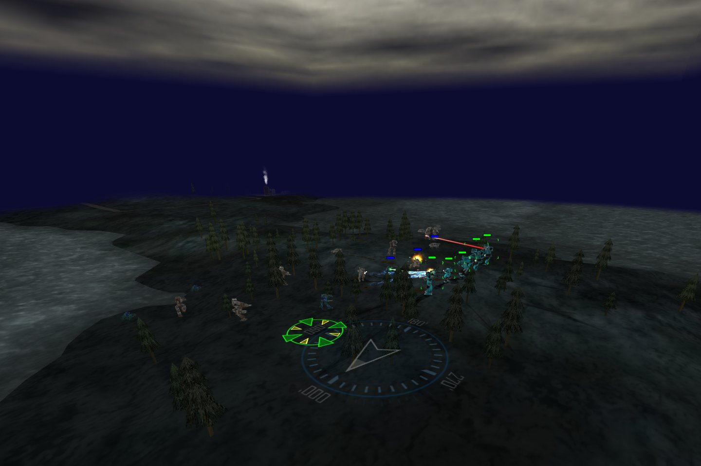
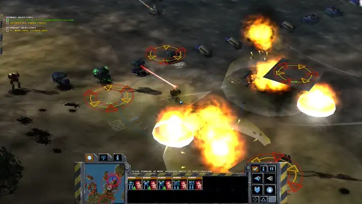
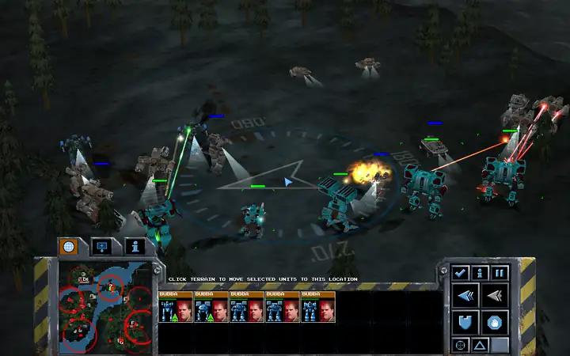
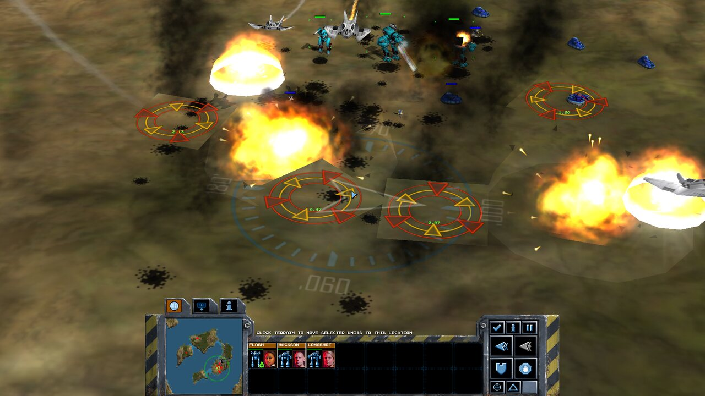
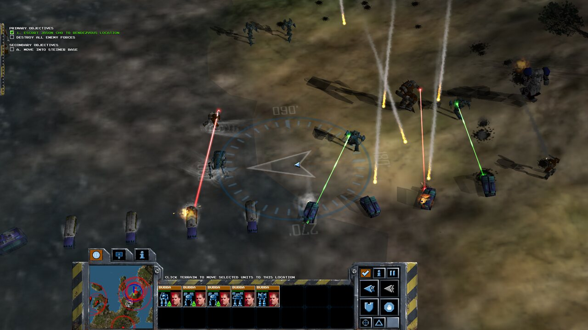
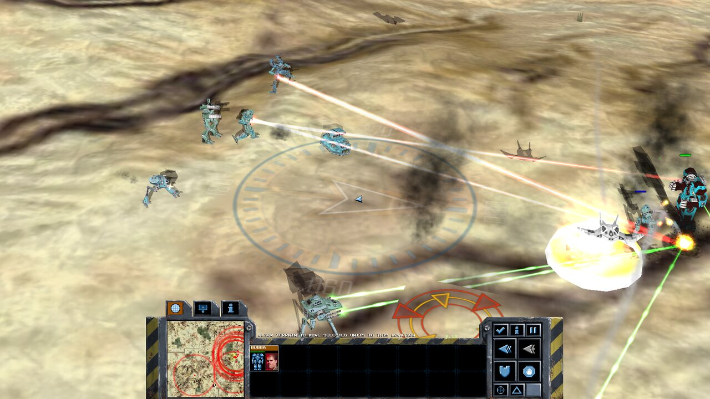
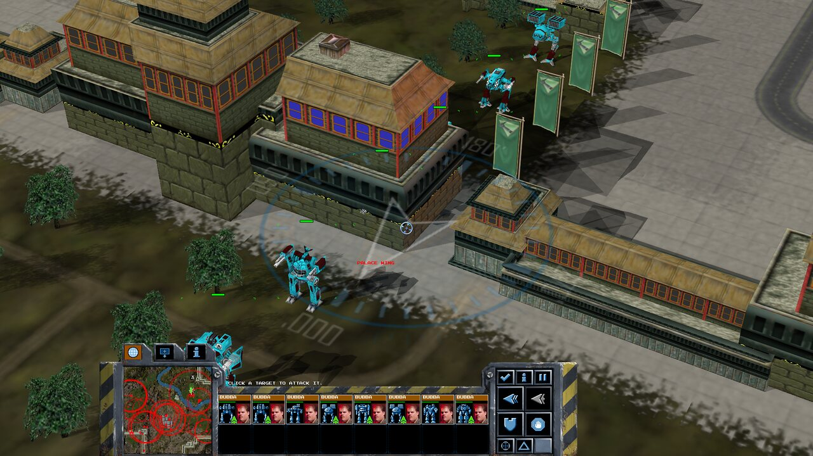

# MechCommander 2 in VR

[](https://github.com/nicholasthorn/mc2-pi/actions/workflows/ci.yml)

**MechCommander 2, playable in VR on a Meta Quest 2**: standalone, no PC
needed to play, with the game's own battlefield in stereo, the camera
following your head, and the Touch controllers to select and order units,
pan, turn and zoom. The 2D interface floats on a panel in front of you.

It is built on a maintained update of
[alariq's open-source MechCommander 2 engine](https://github.com/alariq/mc2):
current compilers, crash and undefined-behaviour fixes, mod support
(MechCommander Omnitech and wolfman-MC2X), network play, and a test,
sanitizer and CI setup around the original code. The same engine also runs
flat, on **Windows, Linux (x64 and arm64), the Raspberry Pi 4/400 and
Android** (the Quest build is an Android app); those builds come along with
the VR work rather than leading it.



*Mission 19 in a Quest 2: the left eye's view, captured on the headset (the
interface panel and controller beams are separate layers, not in this
image). The flat screenshots below are from the Linux build.*

| | |
|---|---|
|  |  |
| *Artillery on a battle in mission 17* | *Searchlights, lasers and missiles at night in mission 19* |
|  |  |
| *Artillery on the first campaign mission* | *Lasers and missiles, with shadows and detail textures on* |
|  |  |
| *The fan-made [MechCommander Omnitech](https://www.moddb.com/mods/mechcommander-omnitech) and its Desert Fox campaign* | *A quieter moment: mechs among the palace buildings of mission 22* |

Scripted battles (`bench/media_*.fit`) from the v0.5.0-rc1 Linux package at
1280x800, the resolution where the HUD reads best; Omnitech's from an
earlier build at 1920x1080. The game data, and Omnitech's, are not in this
repository.

## Relationship to upstream

- All credit for the engine port goes to [alariq](https://github.com/alariq/mc2)
  ([website](https://alariq.github.io/mc2-website/)). Game data comes from
  [alariq/mc2srcdata](https://github.com/alariq/mc2srcdata).
- **This fork is developed with AI assistance.** Upstream's README says
  AI-generated code is not welcome there, so please do not send changes from
  this fork upstream, and report problems with this fork here, not to alariq.
- Upstream `master` is merged in from time to time; changes here are kept small
  and local to make that easy.

## VR on the Meta Quest

([planning/future-features/VR-TABLETOP.md](planning/future-features/VR-TABLETOP.md))

| Area | Status |
|---|---|
| Standalone Quest build: Android APK with OpenXR, sideloaded | Playable on a Quest 2; built by the release workflow |
| Head-tracked view, with the game camera covering the headset's field of view and following where you look | Done |
| Touch controllers: point, click and order units, pan, turn and zoom, a button map for run, jump and the other modifier keys | Done |
| Selection groups without number keys (stick clicks and X + stick) | Done |
| Lists on the panel scroll with the right stick (and with the mouse wheel on every platform) | Built, not yet tried in a headset |
| The 2D interface on a floating panel, sharp at the headset's resolution, movable and resizable | Done |
| Frame rate | About 70 fps at the headset's 72 Hz on the `mc2_19` battle bench |
| Mods in the headset | MechCommander Omnitech, and MC2X as its own app beside the stock one |
| Network play with a Quest | A Quest as host and as client against a PC over home Wi-Fi, played unworn; not yet with someone in the headset |
| Still rough | Open checks are in [planning/HARDWARE-TESTS.md](planning/HARDWARE-TESTS.md); only a Quest 2 has been tried, so a Quest 3, 3S or Pro is untested |
| Tabletop mode, battlefield at miniatures scale | Planned, as an option |

## For every platform

| Area | Status |
|---|---|
| Linux builds from Ubuntu 22.04 (GCC 11) to 26.04 (GCC 15), Clang and MSVC fixes | Done |
| Crash and undefined-behaviour fixes, many back-ported from [mc2-opengl-remastered](https://github.com/ThranduilsRing/mc2-opengl-remastered), more found by sanitizers, cppcheck and fuzzing | Done, ongoing |
| Fatal engine errors (`STOP`) end the game with a message instead of carrying on into a crash | Done |
| Mod content: [MechCommander Omnitech](https://www.moddb.com/mods/mechcommander-omnitech), with all 28 Clan Wars missions, its front end and mech lab, and fan campaigns | Done: all missions load and pass a headless smoke run; mission 1 checked in play |
| Mod content: wolfman-MC2X (R70, the REAP3 campaign, Dark Gray), on its own interface, with its formations, support units and unit buttons; `scripts/mc2x_import.py` builds a game folder from your own downloads | Done: all 32 missions pass a smoke run under ASan + UBSan and REAP3 plays from the menus; the new HUD features are not yet checked by hand ([MC2X-COMPAT.md](planning/future-features/MC2X-COMPAT.md)) |
| Multiplayer on the local network, through the original screens: host, browse, lobby, mech selection, chat, results | Done between processes and machines, also with a Quest; the screens tested by a scripted walker, not yet by hand ([NETWORKING.md](planning/future-features/NETWORKING.md)) |
| Stereo panning for positional sound | Done |
| CI: four build configurations, unit tests (also under ASan + UBSan), shader validation, smoke missions, multiplayer battles, cppcheck, nightly fuzzing | Done; the cppcheck baseline is empty (every finding fixed or suppressed with a reason) |
| Benchmarks: deterministic `-bench` runs, scripted battle scenarios with screenshots, `perf` profiles of gameplay frames | Done |
| Downloadable builds (Quest, Windows, Linux, Pi) | Release candidates on the [Releases](https://github.com/nicholasthorn/mc2-pi/releases) page ([planning/RELEASES.md](planning/RELEASES.md)); `-full` packages include the game data, the Quest still needs a PC to install ([plan](planning/future-features/EASY-INSTALL.md)) |

## Cross-platform

The VR build shares its engine, renderer and data with the flat builds, so
they all stay working. Nice to have, and kept green by CI:

| Platform | Renderer | Built in CI | Run on |
|---|---|---|---|
| Meta Quest 2 (standalone, Android arm64) | OpenGL ES 3.1 + OpenXR | Release workflow, nightly and on tags | A Quest 2, by hand |
| Windows x64 (MSVC, VS 2022) | Desktop GL 4.x | Yes | Windows PCs |
| Linux x64 (GCC, Clang) | Desktop GL 4.x | Yes | Ubuntu 22.04 to 26.04; smoke missions in CI |
| Linux arm64 / Raspberry Pi OS 64-bit (GCC) | OpenGL ES 3.1 | Yes | A Pi 400 at about 800x600: mc2_01 at 179 fps and mc2_03 at 181 fps with vsync off (60 with it on); smoke missions in CI |
| Android (other than the Quest) | OpenGL ES 3.1 | The same APK build | Untested: the app is made for a headset |
| WSL2 / no GPU | Either, via Mesa llvmpipe (`LIBGL_ALWAYS_SOFTWARE=1`) | Smoke runs | |

The Raspberry Pi is where this fork started, hence the branch name `pi-port`
and the repository name `mc2-pi`: an OpenGL ES 3.1 renderer
(`-DMC2_GLES=ON`) for the Pi's V3D GPU, shaders valid as both GLSL ES 3.10
and GLSL 4.20 with `#version` chosen at runtime, and the arm64 fixes
(signed `char`, a portable heap, GCC 12). The Quest build uses the same
renderer.

## Quick start

**On a Quest:** sideload the release's `.apk` and push the game data and
shaders with `adb` from a PC, once; after that the game runs on the headset
alone. The steps are in [dist/INSTALL.md](dist/INSTALL.md), and building the
APK yourself in [android/README.md](android/README.md).

**On a PC or a Pi** (release packages on the
[Releases](https://github.com/nicholasthorn/mc2-pi/releases) page): download
the `-full` one for your platform, unpack and play. On Windows that is all; on
Linux and the Pi install a few libraries first (same file). Engine-only
packages, without the game data, are there too.

**From source:** full instructions in [BUILD-LINUX.md](BUILD-LINUX.md),
[BUILD-PI.md](BUILD-PI.md), [BUILD-WIN.md](BUILD-WIN.md).

**1. Build the game** (Linux; on the Pi add `-DMC2_GLES=ON`):

```bash
cmake -S . -B build -G Ninja -DCMAKE_BUILD_TYPE=RelWithDebInfo
cmake --build build
```

**2. Build the game data** from a `mc2srcdata` checkout. The result is platform
independent: build it once and copy it to each machine, the Pi included.

```bash
git clone https://github.com/alariq/mc2srcdata.git ../mc2srcdata
scripts/build_gamedata.sh --src-data ../mc2srcdata --build-dir build --out ~/mc2exe
```

`--no-movies` skips the movies (the only part stored in Git LFS); missions run
without them.

**3. Run** from the game directory (copy `mc2`, `libmc2res_64.so` and `shaders/`
into it):

```bash
./mc2                      # main menu
./mc2 -mission mc2_01      # straight into a mission
```

## Development

| Check | Command | In CI |
|---|---|---|
| Unit tests (doctest, CTest) | `ctest --test-dir build --output-on-failure` | Every PR push and `pi-port` push, all four configurations; also under ASan + UBSan |
| Shader validation (GLSL ES 3.10 + 4.20) | `python3 scripts/validate_shaders.py` | Same as the unit tests |
| Smoke runs (missions under Xvfb + llvmpipe) | `scripts/smoke.sh --game-dir ~/mc2exe --build-dir build` | Nightly and on PRs that touch code: x64 desktop GL and arm64 GLES; sanitized on x64 |
| Benchmark (on the Pi, own display) | `scripts/bench.sh --game-dir ~/mc2exe --build-dir build --renderers gpu` | No: run by hand |
| Static analysis | `scripts/cppcheck_gate.py` against `scripts/cppcheck-baseline.txt` | Changed files on the same pushes, full tree nightly |

A push that changes only docs, or only merges `pi-port` into a PR, skips the
build and smoke jobs once the previous push passed (`scripts/ci_skip.sh`).

- Sanitizer builds: configure with `-DMC2_SANITIZE=address,undefined` (GCC/Clang).
- New source files build with `-Wall -Wextra -Werror` (`MC2_STRICT_WARNINGS`).
- `-autoexit <frames>` quits cleanly after that many gameplay frames (used by
  the smoke runs). Such a run ignores the keyboard and mouse and runs
  windowed, so it behaves the same on any display.
- `-bench <csv>` makes a run deterministic (fixed game step, fixed seed) and
  writes per-frame timings; `bench/README.md` describes scripted scenarios.
- A `STOP` (a fatal engine error) shows a message box and ends the game.
  `MC2_STOP_EXITS=0` makes it log and carry on instead, to see more than one
  problem in one run when bringing up mod data.
- `MC2_VSYNC=0` turns vsync off (on by default), to measure frame rate past
  the display refresh rate.
- `MC2_SHADER_HOT_RELOAD=1` reloads shaders when their files change (off by
  default: it polls the shader files twice a second).
- Workflows: [ci.yml](.github/workflows/ci.yml),
  [smoke.yml](.github/workflows/smoke.yml),
  [static.yml](.github/workflows/static.yml),
  [release.yml](.github/workflows/release.yml) (packages and a draft release
  from a `v*` tag; a dry run nightly and on packaging PRs).
- Release packages: `scripts/package.sh --build-dir build --platform
  linux-x86_64 --version vX.Y.Z` (also `rpi-arm64`, `windows-x64`).

Conventions for contributors and AI agents are in [CLAUDE.md](CLAUDE.md) and
[.claude/rules/](.claude/rules/). Progress and plans live in
[planning/](planning/).

## Known issues

- Multiplayer is local network only, and the screens are tested by a
  scripted walker, not yet by hand; a Quest has played unworn, not with
  someone in it.
- MC2X's own HUD features (formations, its support units, the unit buttons)
  are this port's reading of one line of help each, unchecked in play.
- Sound: no doppler (stereo panning works).
- The in-mission HUD is a fixed number of pixels, so it is centred but small on
  1440p and 4K screens.
- WSLg's GPU driver shows a white screen with desktop GL; use
  `LIBGL_ALWAYS_SOFTWARE=1`.

The full list is in [planning/PROGRESS.md](planning/PROGRESS.md).

## Plans

- **VR** ([planning/future-features/VR-TABLETOP.md](planning/future-features/VR-TABLETOP.md)):
  polish from playtesting the standalone build (the open checks in
  [planning/HARDWARE-TESTS.md](planning/HARDWARE-TESTS.md)), a Quest 3, a
  network game with people in headsets, and later, as an option, a tabletop
  mode with the battlefield at miniatures scale.
- **Easier install**: a one-file Quest install with no PC step, and an
  Omnitech helper
  ([planning/future-features/EASY-INSTALL.md](planning/future-features/EASY-INSTALL.md)).
- **Downloadable builds** on GitHub Releases
  ([planning/RELEASES.md](planning/RELEASES.md)): the packaging and the
  release workflow are built (a Quest APK, a Windows zip, a Linux x64 tarball
  and a Pi 4/400 tarball; `-full` versions with the data in). Next: release
  candidates checked by hand on a Quest 2, Windows, Linux and a Pi 400 and
  published, then Linux AppImages.
- **Mods** ([planning/future-features/MOD-COMPAT.md](planning/future-features/MOD-COMPAT.md),
  [MC2X-COMPAT.md](planning/future-features/MC2X-COMPAT.md)): more Omnitech
  campaigns, and MC2X's CVE-G campaign when its download can be fetched.
- **Quality** ([planning/QUALITY-ROADMAP.md](planning/QUALITY-ROADMAP.md)): more
  unit tests, sanitized smoke on arm64, smoke runs that reach the save/load
  screens, a reproducible data build, and a Pi as a self-hosted CI runner.
- **The Pi**, as a nice to have: the render backlog in
  [planning/future-features/PI-RENDER-PERF.md](planning/future-features/PI-RENDER-PERF.md),
  starting with the frame spikes from files loaded during play.

## Repository layout

```
GameOS/      platform layer: SDL window, input, sound, GL / GLES renderer core
mclib/       engine: files and archives, terrain, textures, ABL scripting, effects
code/        game: missions, mechs, AI, UI screens, save/load
gui/         UI widget framework
shaders/     GLSL shared by both renderers
data_tools/  makefst, pak, aseconv, makersp (build the game data)
tests/unit/  doctest unit tests
scripts/     smoke runs, data build, shader validation, cppcheck gate
planning/    progress log, roadmap, future features
android/     Quest app: manifest, activity, build notes
media/       images for this page
```

## Licensing

- The original game is released under the Shared Source Limited Permission
  License (see [EULA.txt](EULA.txt)). Game data is not in this repository;
  the `-full` release packages include it, non-commercially, under that licence.
- alariq's code is licensed under GPL v3 (see [license.txt](license.txt)), and
  so are the changes in this fork.
- Third-party libraries use their own licenses; release packages list them
  in `licenses/` ([dist/licenses/](dist/licenses/)).
